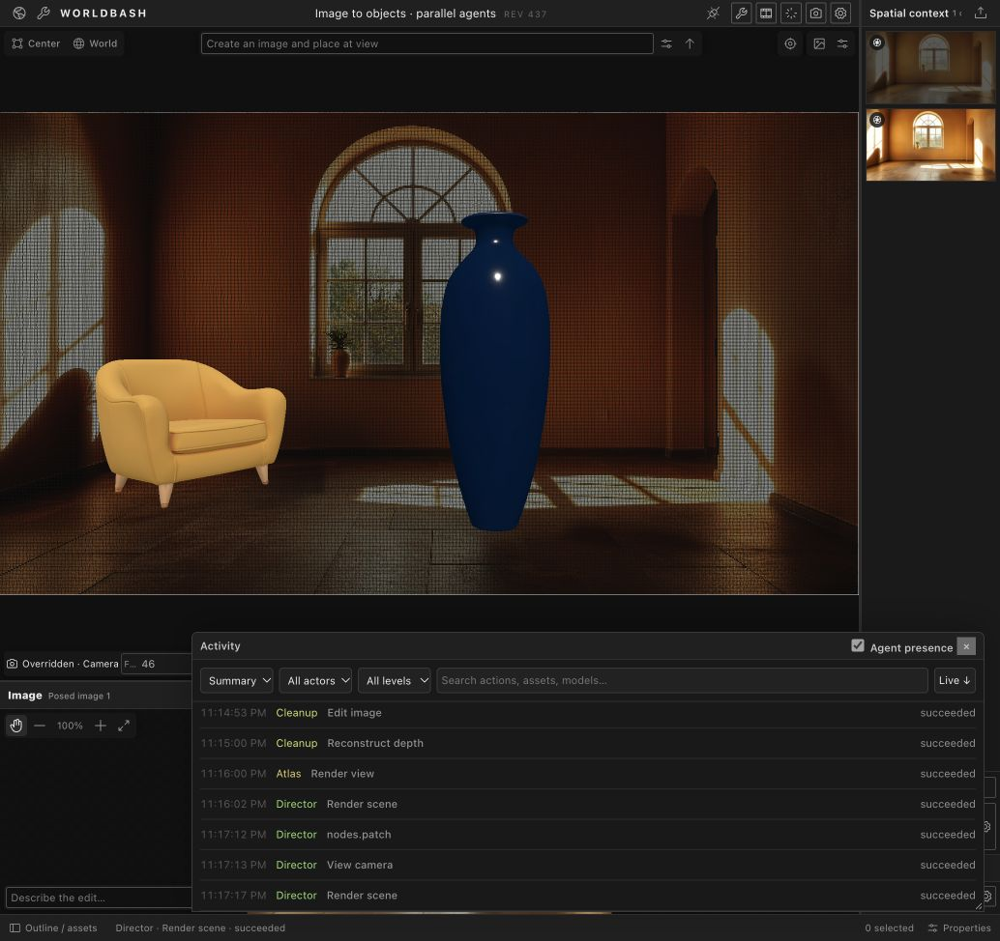

# Image-to-objects build and demonstration

Implemented and exercised on November 13, 2026. The research and architectural
plan is in [IMAGE_BLASTER_PLAN.md](IMAGE_BLASTER_PLAN.md); the exact workflows are
in [skills/worldbash/SKILL.md](skills/worldbash/SKILL.md).

## Open the result

The independent demo project is saved locally at:

```text
.worldbash-demos/decomposition-2026-11-14
```

To reopen it later from this repository:

```sh
bun run worldbash open .worldbash-demos/decomposition-2026-11-14 --port 4318
```

The full demo project is excluded from Git; a screenshot is included below.
The reopen command requires that local project to be present. Existing user projects were
not used as fixtures. This build uses project schema 5 and rejects older schemas
without rewriting them.

## What the real demonstration did

1. Generated a new studio reference image through FAL and posed it through the
   public World Labs `images2PosedRGBD` task.
2. Observed the chair and vase independently, saving source-camera/depth evidence,
   crops, foreground masks, unchanged masks and provenance.
3. Completed isolated object images with Nano Banana, then generated two textured
   GLB meshes through the public Hunyuan 3D endpoint.
4. Ran **two actual subagents concurrently**, one owning the chair and one owning
   the vase. Each placed its own node, requested a read-only fit, applied guarded
   transforms, rendered its own source-camera comparison and a second view, and
   refined the fit visually. Neither changed the human camera, selection, source
   capture, or the other worker's object.
5. Coordinated one shared background removal. Visual review caught rectangular
   seams in the first composite; dilation and feathering fixed the transitions.
   White mask pixels were preserved locally. Reconstructed depth used unchanged
   evidence, and RGB plus geometry were applied together.
6. Generated a translated Atlas view from the cleaned RGBD context, then rendered
   the new static view together with the two editable meshes. No splat task ran.
7. Retained all jobs, inputs, outputs, histories and automatic actor activity in
   the saved project. All **28 demo jobs succeeded**; there are **86 assets** and
   two separately editable mesh nodes.

The final editor opens at the Atlas continuation camera. The original cleaned
capture remains available but hidden to avoid drawing overlapping point clouds.
The image editor retains the original reference for comparison.

## Visual evidence



Additional evidence is saved in the local demo's `presentation/` directory
and is not included in the repository:

| Artifact                           | Local filename           |
| ---------------------------------- | ------------------------ |
| Original posed reference           | `original.png`           |
| Cleaned background                 | `clean-plate.png`        |
| Decomposed original camera         | `decomposed-source.png`  |
| Original/result comparison         | `source-comparison.png`  |
| Atlas continuation without objects | `atlas-continuation.png` |
| Final view with editable objects   | `final-atlas-with-objects.png` |

The generated meshes approximate the reference. Their silhouette placement is
close after iteration, but fabric detail, material response and cast shadows are
not photorealistic matches. The background is RGBD point geometry; it is not a
complete hidden-surface reconstruction. The single-view fit is intentionally a
proposal, not an automatic quality judgment or a claim of metric accuracy.

## Implemented tools and guarantees

- `models`, `model`, and typed `generate` provide model discovery and general
  public image/3D model calls. Native input JSON supports local asset references.
- `observe`, `mask`, asset-only image edits, `fit`, and `render` are composable.
  Regions can use boxes, polygons or imported masks. Masks support union,
  intersection, dilation, inversion and feathering.
- GLB meshes use shared node transforms, capabilities, parenting, picking, bounds,
  properties and undo. Required unsupported GLB extensions and external resources
  are rejected explicitly.
- Headless renders use an installed Chrome/Chromium and the shared SceneGraph.
  Color, reference comparison/overlay, mesh masks/IDs and linear EXR depth are
  saved with a camera and bounds manifest. They do not puppet an editor viewport.
- Narrow patches, field preconditions, durable idempotency receipts, immutable
  input bytes and guarded edit reverts support concurrent workers. The existing
  result ownership rules prevent older generation from reclaiming a destination.
- Scene edits wait for depth refresh by default. Failed refresh retains the old
  active scene and candidate assets. `--wait --ready` follows automatic child jobs.
- Automatic activity records command/job lifecycles and resources. The UI has
  Summary, Actions and Trace detail; actor/severity/search filters; resource badges;
  and optional ephemeral viewport markers. These are editor state, excluded from
  scene bounds, picking and generated views. Agents do not emit presentation events.

## Verification

- `bun run check`: passed.
- `bun run test`: **157 passed, 0 failed; 1,069 assertions**.
- `bun run build`: passed. Vite reports the existing large client-bundle advisory.
- Fresh copy with `bun install --frozen-lockfile --offline`: passed (464 packages).
- Clean-install launch on port 4319 with a separate empty project: passed; stopped
  after verification.
- Actual Chrome render test checks a known mesh's silhouette and linear depth and
  verifies that scene nodes, selection and editor settings remain unchanged.
- Regression checks cover stale guards, disjoint field edits, receipt replay,
  guarded revert, pinned input bytes, scaled-parent depth observations, unchanged
  RGB compositing, staged result ownership and activity expiry.
- Real-provider demo and two parallel CLI workers completed; UI layout, filters,
  activity history and saved scene were reviewed in the browser.

Current explicit boundaries: geometry mask/ID/depth passes require mesh targets;
point/splat color rendering remains supported. Headless rendering requires a local
Chrome/Chromium installation and never downloads a browser at startup. Initial
placement and generated geometry still require visual review. Interrupted file
operations without a completed receipt must be inspected before resubmission;
saved generation jobs recover by their request identity.
