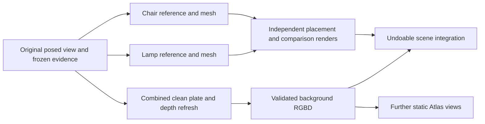

# Image decomposition and agent collaboration in worldbash

Research and build review, November 13, 2026.

Build a set of general editor and generation tools that lets an agent turn parts of a posed image into independently editable 3D objects. The agent should be able to inspect a view, isolate and complete an object, generate a mesh, position it against the original view, remove its image counterpart, refresh the background geometry, and continue building the static scene with Atlas.

The central design choice is to put reliable operations in worldbash and creative sequencing in the agent. An optional decomposition skill can teach useful techniques and delegate work, but there should be no mandatory “blast” pipeline, object directory structure, scene analysis document, or automatic splat generation.

This document covers implementation contracts, CLI design, independent rendering, concurrent agents, editor-owned activity and spatial presence, delivery phases, and acceptance criteria. The implemented interface is summarized first; the original research and exploratory design follow. See [DECOMPOSITION_DEMO.md](DECOMPOSITION_DEMO.md) for the completed real-provider demonstration and validation results.

## Implemented contract (build review)

The implementation uses a smaller CLI vocabulary than the exploratory examples below:

| Capability                        | Shipped interface                                                                                                                                                     |
| --------------------------------- | --------------------------------------------------------------------------------------------------------------------------------------------------------------------- |
| General generation and discovery  | `models [endpoint] [--search text]`, `model <endpoint> --file input.json`, `generate --file request.json`                                                             |
| Source evidence                   | `observe <capture> --region x,y,w,h [--polygon file                                                                                                                   | --mask asset]`; crop, masks, camera, depth statistics and guarded observation manifest |
| Mask composition                  | `mask <asset>... --operation union                                                                                                                                    | intersection --dilate N --invert`                                                      |
| Extraction / completion / removal | Free-form `image edit`; `--asset-only` for object preparation; `--targets` for explicit capture application                                                           |
| Background cleanup                | `image edit --unchanged-mask`; white pixels copied exactly from source, unchanged-region scale fitting, atomic RGBD scene application                                 |
| Mesh scene editing                | Self-contained GLB import/placement; ordinary `nodes.patch`, transform, parenting, duplication, deletion and undo                                                     |
| Placement                         | `fit <node> --observation <asset>`; proposed transform and exact source/ancestor preconditions; explicit application                                                  |
| Independent views                 | `render <camera/capture>` or typed render request, temporary transform overrides, color/reference comparison/overlay, mesh mask/IDs/linear EXR depth, bounds manifest |
| Collaboration                     | Field preconditions, atomic narrow edits, durable request receipts, content-addressed input snapshots, guarded `revert`, separate rendering/provider slots            |
| Activity                          | Automatic persisted bounded event stream; Summary/Actions/Trace, actor/severity/search filters, resource badges, optional non-pickable viewport presence              |

`schema generation` and `schema context` are authoritative. Workflow conveniences
remain compositions of these primitives, not another pipeline or file convention.
`--wait --ready` follows automatic posing/reconstruction to completion. Raw FAL
transport shares the existing job runner; supported World Labs tasks remain public
SDK calls. No automatic splat generation was introduced.

The renderer requires locally installed Chrome/Chromium and never downloads one
at startup. It supports mesh geometry passes; point/splat depth and ID passes
explicitly fail. Fit uses conservative bounds and median depth, so orientation,
contact and silhouette still require visual iteration. The real demo deliberately
exercises that iteration. GLB assets with external resources or unsupported required
compression extensions fail clearly. Jobs retain their inputs and raw results;
project schema 5 rejects old project files without rewriting them.

The original review plan and research below record the intended design and its
tradeoffs. Proposed names in those sections are illustrative; the table above and
CLI help document the implemented names.

## What to carry forward from image-blaster

The reviewed image-blaster revision is [4acb43b](https://github.com/neilsonnn/image-blaster/tree/4acb43ba126a12358f71838d1b1a05e856b10eaf). The worldbash baseline is local commit `f5729c8f296a9807fcd2622ca374a02aa4bc5eda`.

Image-blaster has a useful separation between image analysis, object reference generation, mesh generation, clean plates, and general model calls. Its [object skill](https://github.com/neilsonnn/image-blaster/blob/4acb43ba126a12358f71838d1b1a05e856b10eaf/.claude/skills/image-blast-3d/SKILL.md) and [generator](https://github.com/neilsonnn/image-blaster/blob/4acb43ba126a12358f71838d1b1a05e856b10eaf/.claude/scripts/asset-pipeline/generate-single-asset.mjs) already support stopping after the reference image, reusing that image for another mesh attempt, and resuming saved provider requests. Those are valuable behaviors to preserve.

| Image-blaster behavior                                     | Worldbash direction                                                                                    |
| ---------------------------------------------------------- | ------------------------------------------------------------------------------------------------------ |
| One background agent per object                            | Keep independent object work, using ordinary CLI clients against one server.                           |
| Isolate one identifiable physical object                   | Keep as a useful prompt recipe; allow assemblies, architectural pieces, and other user-defined scopes. |
| Reuse references and retry mesh generation separately      | Keep separate jobs and assets so each stage can be revised independently.                              |
| Combine removals into one clean plate                      | Keep as the default strategy for several objects in the same view.                                     |
| Generic FAL discovery and execution                        | Bring into the normal generation and asset system.                                                     |
| Durable downloads and request metadata                     | Keep in WorkspaceStore assets and jobs.                                                                |
| Prescribed folders, indexed filenames, and analysis JSON   | Replace with IDs, provenance, schema discovery, and command receipts.                                  |
| Automatic environment splats and object sounds             | Leave outside this feature. Existing splat generation stays an explicit action.                        |
| Rules discouraging agents from inspecting generated images | Replace with visual iteration using isolated renders and comparison images.                            |
| Fixed object approval and generation sequence              | Let user instructions determine autonomy and scope; do not reconfirm every routine step.               |

These differences are grounded in image-blaster’s [project rules](https://github.com/neilsonnn/image-blaster/blob/4acb43ba126a12358f71838d1b1a05e856b10eaf/.claude/rules/project.md), [analysis specification](https://github.com/neilsonnn/image-blaster/blob/4acb43ba126a12358f71838d1b1a05e856b10eaf/.claude/skills/image-blast-uncover/IMAGE-BLAST.md), [clean plate skill](https://github.com/neilsonnn/image-blaster/blob/4acb43ba126a12358f71838d1b1a05e856b10eaf/.claude/skills/image-blast-plate/SKILL.md), and [wildcard skill](https://github.com/neilsonnn/image-blaster/blob/4acb43ba126a12358f71838d1b1a05e856b10eaf/.claude/skills/image-blast-wildcard/SKILL.md).

Two implementation details should not be carried over. The [index helper](https://github.com/neilsonnn/image-blaster/blob/4acb43ba126a12358f71838d1b1a05e856b10eaf/.claude/scripts/asset-pipeline/request-metadata.mjs) computes the next index by scanning existing files; it does not reserve that index atomically. That is insufficient coordination for two agents writing the same asset family. Also, category-level deduplication with a count estimate is useful for analysis but insufficient for placement: two similar chairs need distinct scene instance IDs, even when they share one mesh asset.

## Existing worldbash foundations and concrete gaps

| Area               | Existing implementation                                                                                             | Needed extension                                                                                                      |
| ------------------ | ------------------------------------------------------------------------------------------------------------------- | --------------------------------------------------------------------------------------------------------------------- |
| Persistence        | WorkspaceStore serializes updates, validates state, writes atomically, and locks the project to one server process. | Guard stale client edits and bind job inputs atomically. Serialization alone does not prevent lost updates.           |
| Commands           | UI and CLI share commands, batches, graph validation, and undo.                                                     | Server-side field patches and transform operations, request IDs, actor attribution, and preconditions.                |
| Jobs               | Nonblocking submission, three concurrent runner slots, remote IDs, cancellation, retry, and result downloads.       | Separate local-render/provider capacity, dependency readiness, reusable output roles, and explicit destinations.      |
| Result application | Latest submission owns destinations; reconstruction children inherit ownership; results apply at most once.         | Extend to mesh bindings and staged RGBD activation without changing those rules.                                      |
| Images             | Nano Banana edits, reference images, drafts, history, automatic child reconstruction.                               | Region/mask operations, extraction as an independent asset, precise destination scope, and robust geometry readiness. |
| General models     | `fal <endpoint> --file input.json` already accepts nested `{"$asset":"id"}` inputs and saves files/results.         | Discovery, schema validation, typed outputs, mesh integration, and routing through `generation.submit`.               |
| Posed views        | Shared camera/image/points composition and workflow validation.                                                     | Pixel-to-world tools and explicit RGB/depth compatibility.                                                            |
| Rendering          | `capture --camera` renders an explicit camera using the open viewport renderer.                                     | A separate render worker that needs no user viewport.                                                                 |
| Inspection         | `scene inspect` uses renderer bounds; `--headless` returns structural metadata with null bounds.                    | Renderer-backed inspection through that worker.                                                                       |
| Preview            | `scene preview` produces headless contact sheets from existing images.                                              | Retain it; add actual scene renders and render/reference comparisons.                                                 |
| 3D assets          | Points and splats render; there is no mesh node or GLB asset kind.                                                  | First-class mesh assets and nodes using shared spatial contracts.                                                     |

Relevant local sources: [store](/Users/neilsonkoerner-safrata/WLT/worldbash/web/src/server/store.ts), [commands](/Users/neilsonkoerner-safrata/WLT/worldbash/web/src/server/commands.ts), [jobs](/Users/neilsonkoerner-safrata/WLT/worldbash/web/src/server/jobs.ts), [result ownership](/Users/neilsonkoerner-safrata/WLT/worldbash/core/result-targets.ts), [image results](/Users/neilsonkoerner-safrata/WLT/worldbash/web/src/server/image-results.ts), [schema](/Users/neilsonkoerner-safrata/WLT/worldbash/core/schema.ts), [scene renderer](/Users/neilsonkoerner-safrata/WLT/worldbash/web/src/lib/scene.ts), and [CLI](/Users/neilsonkoerner-safrata/WLT/worldbash/cli/index.ts).

There are four particularly relevant gaps in current behavior:

1. `scene transform` reads a node in the CLI and submits a complete replacement. Another edit between those steps can be overwritten despite the store’s queue.
2. Image-edit destinations are discovered through an image family, potentially affecting multiple captures. An object worker needs explicit capture scope or an asset-only output.
3. Edited RGB can become active while previous geometry is retained. Structural alignment checks do not establish that the old depth still describes the new pixels.
4. `image.create` creates a capture and chains posing. General object-reference creation also needs a library-only destination with no automatic pose job.

## Intended experience

The user imports several references, poses overlapping images together, and asks: “Make the chair and lamp independent objects, leave the rest as the room, then extend the room with Atlas.”

The coordinating agent identifies the two physical instances and gathers their original image regions and geometry evidence. A chair agent and lamp agent independently create object references, generate meshes, fit them, and render comparisons. A background worker prepares a clean plate containing both removals and refreshes its depth. The coordinator activates the accepted results and builds further static views from the cleaned context.

Every stage remains individually accessible. An agent can generate a mesh from a wholly new prompt, edit an existing object, import a manually modeled asset, remove an object without reconstructing it, or extract only a reference image. A generated camera-only image can be extracted in 2D immediately; placement using depth requires posing first or an explicitly supplied placement.



The dependency here is on usable outputs, not a fixed order of agent actions. A user can authorize immediate per-object integration or a combined final commit. The default decomposition recipe should keep the original capture usable while replacements are being prepared.

## Keep the scene and asset contracts small

### Mesh assets and nodes

Add `mesh` to the asset and node contracts, starting with self-contained GLB. A mesh node references an asset and uses `node.transform` as its only editable pose. Several nodes can instance the same asset.

The loader may retain internal GLTF hierarchy as geometry content. Declare or normalize source axis, units, and pivot once at the import boundary; record the normalization as asset provenance. Do not add a second placement transform hidden in a loader or object-generation record. Do not silently normalize every mesh to an assumed real-world size.

Provide NodeSpatial extents, an optional interaction center, and the selection target. Register supported transforms in `core/node-capabilities.ts`. Picking, bounds, selection outlines, parenting, framing, duplication, export, and undo should work through their current shared paths. Any supported clipping behavior must use a declared geometry capability and the same parent/subtree rules; an unsupported clip operation must be explicit.

The first release supports static GLB meshes and their materials. Preserve additional provider outputs as assets, but do not imply that arbitrary OBJ bundles, rigs, animation, or physics are implemented. Retain embedded textures, release GPU resources correctly, and test mirrored texture/axis mistakes with asymmetric fixtures.

### Image regions and source observations

A reusable observation should identify an exact source RGB asset/version, optional posed-view components, a box/polygon/mask, source pixel dimensions, and optional placement evidence. Store reusable observations as typed project assets with immutable payloads; use ephemeral JSON inputs when persistence is unnecessary. They are evidence, not scene nodes and not a second scene database.

For a posed observation, record the participating image and points bindings, calibrated projection, world matrices at observation time, and hashes of the source bytes. Capturing these values is legitimate source provenance. Once a mesh is placed, its current pose comes exclusively from its node.

Use one explicit image-coordinate convention: pixel centers, origin at top left, x right, y down, and a declared raster size. Record crop/resize/padding mappings. Map masks to the original image and depth grid through these mappings, never through a guessed normalized rectangle. Generated object references may change framing and invent unseen surfaces; they are not automatically calibrated views.

Observations may group several views of the same physical instance. Matching that instance across views is initially an agent decision supported by geometry. Repeated but distinct objects retain separate identities; mesh reuse is a separate decision.

### Provenance and generation outputs

Keep job ID, endpoint/task, request parameters, source assets, observation IDs, output roles, and source hashes together. Use output roles such as `image`, `mask`, `mesh`, `depth`, `thumbnail`, and `raw-result` so agents do not guess from array order or filenames.

An extracted reference has derivation provenance but starts an independent image family. It must not become a replacement version of the room merely because it came from room pixels. A clean plate is a replacement candidate for the source view. Separate those relationships explicitly.

Generated artifacts get unique IDs and files owned by the store. Agents can choose human-readable names and export paths. They do not need to manage numbered files, hidden request sidecars, or `object.json` state.

## Proposed CLI suite

Preserve existing nouns where they fit. Add schemas beside owning contracts and expose them through `schema`; avoid a separate command family that reimplements editing. Local deterministic operations run as local jobs when expensive. All paid generation, including raw provider calls, enters `generation.submit`.

| Command family | Proposed operations                                                  | Behavior                                                                                               |
| -------------- | -------------------------------------------------------------------- | ------------------------------------------------------------------------------------------------------ |
| `models`       | `search`, `show`, `schema`                                           | Discover public endpoints and inspect supported inputs/outputs without generating.                     |
| `generate`     | `--provider`, `--model`, `--input`, `--destination`                  | General generation; retain raw result and assets. Default to assets, with explicit scene destinations. |
| `image`        | `crop`, `mask`, `extract`, `outpaint`, `remove`                      | Local regions plus convenient image-edit requests. Each can run independently.                         |
| `image edit`   | explicit `--target`, asset-only destination, mask, references        | Keep free-form editing; narrow application scope and trigger required refresh for posed destinations.  |
| `view`         | `inspect`, `observe`, `sample`, `refresh`, `apply`                   | Resolve a posed view, capture evidence, query depth, refresh candidate RGBD, and activate it.          |
| `mesh`         | `generate`, `inspect`                                                | Generate a mesh from image/text using a known adapter, or report imported geometry properties.         |
| `scene`        | `render`, `project`, `fit`, `patch`, existing transform/place/remove | Observe and manipulate the shared scene without changing the user's camera.                            |
| `jobs`         | existing status/wait/retry/cancel plus output/dependency filters     | Report provider completion separately from geometry readiness and scene application.                   |
| `history`      | guarded `revert <edit-id>`                                           | Compensate an agent's own edit through the existing journal.                                           |

`image mask` should create masks from polygons or imported masks locally. Semantic segmentation is an optional model call through `generate`, not a mandatory service. A rough box is enough to start an extraction prompt; precision masks improve placement evidence and cleanup.

Distinguish a real provider mask from visual annotation guidance. The current Nano Banana draft is guidance, not a pixel-preservation guarantee. Adapters must declare whether they accept masks; unsupported masks cannot be silently ignored. Where unchanged pixels must be exact, a local composite can preserve pixels outside a feathered region, followed by seam inspection and depth validation. Keep the actual changed-pixel region available for refresh, since a model can alter more than the requested object.

Example proposed exploration commands:

```sh
worldbash view inspect frame_room
worldbash view observe frame_room --polygon chair-region.json --out chair-observation.json
worldbash view sample frame_room --observation chair-observation.json --out chair-depth.json

worldbash image extract --observation chair-observation.json \
  --prompt 'Complete this one chair, including the obscured legs; preserve its materials and proportions'

worldbash models search 'image to 3d'
worldbash models schema fal-ai/hunyuan3d-v3/image-to-3d
worldbash mesh generate --image asset_chair_reference --model fal-ai/hunyuan3d-v3/image-to-3d

worldbash scene place asset_chair_mesh --parent group_objects --name 'Chair'
worldbash scene fit node_chair --observation chair-observation.json --out fit-proposal.json
worldbash command @apply-fit.json

worldbash scene render --camera-node camera_room --include node_chair \
  --reference asset_original_room --passes color,mask --out chair-check.png
```

Each generation returns a job ID immediately. The agent waits for required outputs and takes asset IDs from the job result before issuing the next dependent command. IDs in these examples are placeholders, not shell variables or commands that currently exist.

`scene fit` is read-only by default, like `camera solve`; it returns a proposed transform and evidence. An explicit application command records the edit. A candidate transform can also be passed as a temporary render override, so comparing alternatives does not create a trail of persisted scene edits.

A general model request should remain possible without a specialized wrapper:

```sh
worldbash generate --provider fal \
  --model fal-ai/hunyuan3d-v3/image-to-3d \
  --input request.json --destination assets
```

```json
{
  "input_image_url": { "$asset": "asset_chair_reference" },
  "face_count": 50000,
  "generate_type": "Normal",
  "enable_pbr": true
}
```

The endpoint and field names above are documented by [FAL’s Hunyuan API](https://fal.ai/models/fal-ai/hunyuan3d-v3/image-to-3d/api). The 50,000-face setting is a proposed starting preset inherited from image-blaster, not a quality guarantee or the provider default. Discovery should expose alternatives without hardcoding one model as universally best.

Use a small typed model dictionary for friendly names, capabilities, input mappings, output mappings, and useful presets. General FAL calls accept the model’s native schema. FAL’s [model search API](https://fal.ai/docs/platform-apis/v1/models) exposes endpoint discovery and OpenAPI expansion; cache that metadata with its fetch time and retain the schema used by a submitted job. Unknown outputs stay downloadable assets until an adapter or explicit mapping identifies them.

Replace the current raw FAL submission path with this shared generation path, updating consumers together. Do not create parallel runners. Preserve a direct/synchronous provider transport only for endpoints whose documented interface requires it; transport does not change the worldbash job lifecycle.

## Independent frustum rendering

Use a dedicated headless browser render worker running the same scene renderer as the editor. Initially, one warm renderer with a bounded queue is sufficient. Agents can request renders concurrently even when the GPU executes them serially. Additional isolated workers can be added if measurements justify their memory cost.

Extract reusable rendering initialization and capture behavior from `Viewport.tsx`. Both the interactive viewport and worker instantiate the same SceneGraph, node loaders, projection helpers, clipping behavior, and render code. The worker should load a minimal internal render surface with no fly controls, selection gestures, live editor subscription, or persistence writes.

Each request freezes:

- Scene revision and relevant node records, including ancestors.
- Exact asset versions/bytes and camera intrinsics/world pose.
- Visibility filters, render layers, near/far range, resolution, and optional temporary transforms.
- Requested passes and the reference image, if a comparison is requested.

Produce a PNG plus a machine-readable manifest containing camera, source revision, included nodes, output roles, and renderer errors. Wait for geometry/textures and any required splat sorting before capturing. No fallbacks to the user's viewport, shared selection, active image, or global display settings.

Support these useful outputs in order:

1. Color render with editor helpers excluded.
2. Isolated object silhouette/mask and source-image overlay or side-by-side comparison.
3. Renderer bounds and projected object bounds.
4. Linear camera-space depth, validity, and node-ID passes for supported geometry.
5. Small camera batches/contact sheets for cross-view evaluation.

Do not let a reference image plane hide the very geometry being assessed. Reference pixels belong in an explicit comparison layer; they are excluded from scene depth and object masks. Geometry passes must declare what contributes and what is unsupported. Points/splats may require different depth treatment than opaque meshes; do not label an approximate splat depth buffer as exact geometry.

Document depth as positive camera-forward distance, with units, invalid samples, pixel origin, and clipping planes. Reuse `core/depth.ts` conventions and calibrated projection, including off-center principal points. The same imported scene must produce equivalent geometry, bounds, and camera projections in the worker and interactive renderer.

Choose the pinned Chromium/automation dependency during the first rendering spike. Bundle or explicitly provision it at installation time; startup must never download it. `doctor` checks render support without provider credentials, while ordinary launch and local editing remain usable when optional rendering support is unavailable. Packaging must work from a clean frozen install and a disposable project.

## Placement from the original view

The original view supplies scale and location evidence that an outpainted object image usually loses. Freeze that evidence before cleaning the source view.

`view sample` resolves active points geometry and its current transform through the shared contracts. For selected pixels, unproject valid depth with the matching intrinsic calibration, then transform points into world space. It must respect the current points node and image binding; it cannot reach through the capture parent to substitute an old saved result.

Return robust depth statistics, a filtered point subset or point asset, world-space extents, likely support/contact samples, and diagnostics. Reject or flag invalid depth, too little foreground evidence, incompatible grids, broken capture structure, and geometry with unsupported world transforms. Foreground masks should exclude background and occluders where possible.

Report dimensions in scene units. Do not call them meters unless the scene has an explicit scale calibration. Image-generated geometry and single-view reconstruction do not independently establish a reliable physical measurement.

Initial fitting can combine observed extent, support height, mesh bounds, and an agent-supplied up/forward direction to propose translation, rotation, and uniform scale. Do not treat median visible-surface depth as an exact object center. Do not infer true unseen thickness or a unique orientation from one view.

The agent then renders the candidate from the original camera, inspects the silhouette and contact point, and adjusts. Additional source views constrain ambiguity. Return image-space residuals, mask overlap where a usable mask exists, and depth disagreement on reliable visible surfaces. These are diagnostics; visual likeness is not reducible to a single score.

The MVP needs deterministic sampling, good initial placement, and a fast visual loop. Automatic pose optimization, ICP, differentiable rendering, or exhaustive yaw search can follow only if the agent loop is demonstrably insufficient. Fitting never bypasses transform permissions or silently introduces shear under nonuniform parents.

## Clean plates and depth refresh

Treat a posed-image edit as an RGB candidate followed by a geometry candidate. The recommended default for geometry-changing edits is to activate the new RGB and new depth together once they form a valid result. Both output assets remain inspectable while work proceeds; the original active RGBD stays usable until commit.

If the user explicitly activates unfinished RGB, expose that its geometry is stale and keep it out of Atlas context until refreshed. A generation succeeding is not sufficient evidence that a posed view is ready. Derive compatibility from the active RGB/geometry bindings and their provenance; keep this workflow validity separate from generic undo bookkeeping.

Extend the existing reconstruction path rather than adding a second one:

1. Snapshot the original view, edited image, removal mask, unchanged reference pixels, participating components, and result owner.
2. Estimate new RGBD through the public `images2PosedRGBD` task.
3. Map original and returned RGB/depth into explicit corresponding pixel grids.
4. Recover scale from reliable unchanged scene regions, excluding the edited region and unreliable depth. If insufficient evidence remains, return an unresolved alignment result instead of inventing a scale.
5. Validate the solution against frozen source evidence and any other usable views. Preserve the editable scene placement; apply accepted geometry and projection changes consistently through commands.
6. Apply to the recorded components only if the job still owns them. A deleted/replaced component yields an application error with retained assets.
7. Expose readiness to the agent, then allow cleaned captures into the next Atlas request.

The public posing task estimates cameras and does not accept camera/depth/mask inputs; reconstruction must perform alignment locally. Its documented output grids are 1280×720, 720×1280, 960×720, and 528×704. It can crop/rescale outputs, so retaining old intrinsics by assumption is unsafe. [Atlas posing documentation](https://docs.atlas.worldlabs.ai/images-to-posed-images)

There is an immediate prerequisite in [providers.ts](/Users/neilsonkoerner-safrata/WLT/worldbash/web/src/server/providers.ts): `targetResolution` is currently derived from arbitrary source dimensions. Replace that with validated supported-grid selection, shared with the session format contract, and test crop/intrinsic mappings. The installed SDK documents the same restriction.

The current [reconstruction code](/Users/neilsonkoerner-safrata/WLT/worldbash/web/src/server/reconstruction.ts) estimates single-view scale using a median ratio over old/new depth samples. Extend that calculation to use unchanged-region evidence and confidence. A large removed foreground object must not dominate the scale estimate. Significant framing or calibration drift should leave a candidate awaiting explicit recalibration or another solve; never hide it by assigning incompatible old camera parameters.

For several objects in one view, the coordinator normally combines their masks/removal descriptions into one clean-plate request and one refresh. Separate full-image model outputs cannot safely be merged merely because their intended masks are disjoint. When sequential edits are necessary, the next edit must explicitly use the accepted result of the previous edit.

For several source views, remove the object from every view that will remain in static Atlas context, or explicitly exclude the uncleaned views from that request. Otherwise the object can be generated back into the background. Across views, the agent checks that hallucinated backgrounds agree sufficiently before expanding the scene.

Object meshes remain independent of static Atlas context by default. A later explicit render-to-posed-input operation could bake a scene containing meshes into context, with documented depth and validity semantics. That is a separate choice from decomposing the original image.

## Several agents in one project

Use one authoritative worldbash server and multiple CLI clients. Subagents belong to the host agent system; worldbash does not need to launch or embed an LLM runtime. The same commands should work from different agent hosts or ordinary scripts.

Each delegated task receives explicit project/server identity, actor ID, source observation IDs, output destination, and any limits supplied by the user. Its instructions describe the result to achieve and the tools available. A coordinating agent can assign one object per worker and one cleanup worker per shared source view, but workers remain free to choose their method.

### Commands and conflicts

Add a small command envelope carrying `requestId`, `actorId`, and optional preconditions. The server assigns stable node/edit IDs and returns them in receipts. A repeat of the same request ID and same body returns the original result; reuse with a different body is an error. Check that identity inside the serialized transaction.

For example, a proposed envelope for a binding change is:

```json
{
  "requestId": "replace-chair-attempt-1",
  "actorId": "chair-worker",
  "preconditions": [
    {
      "resource": "node:node_chair",
      "fingerprint": "observed-node-fingerprint"
    }
  ],
  "command": {
    "type": "nodes.patch",
    "id": "node_chair",
    "patch": { "assetId": "asset_chair_mesh_v2" }
  }
}
```

The schema determines the permitted patch fields. A receipt returns the committed revision, request/edit IDs, changed node IDs, and any job IDs. This example uses a whole-node fingerprint for simplicity; transform commands can request the narrower read dependencies they actually need.

Use server-side patches for field edits and server-side transform operations. For a world-space transform or reparenting operation, include the relevant ancestor transforms in the read dependency set. Multi-node changes validate all preconditions before applying any mutation.

Prefer expected values or opaque fingerprints of relevant records/fields over a mandatory global workspace revision. Unrelated job status updates should not invalidate a chair edit. A stale geometry binding, changed parent transform, or deleted destination should invalidate an operation that depended on it. Return a structured conflict naming the changed inputs so the agent can re-read and decide.

For generation, resolving explicit targets, validating preconditions, freezing logical inputs, recording the job, and claiming destinations must be one store transaction. Uploads and provider work happen outside the transaction. Heavy file snapshotting can prepare immutable blobs first, followed by a transaction that verifies their source bindings/hashes are still current.

Keep `core/result-targets.ts` responsible for application ownership. A newer submitted edit to the same destination supersedes the older result; an automatic child inherits its parent's ownership. Ordinary field preconditions protect command execution, while result ownership protects asynchronous application. Do not turn a benign job-status revision or permitted interim image edit into an automatic rejection of the winning job.

### Files and read snapshots

Job inputs and render inputs must pin bytes as well as JSON. Current asset metadata snapshots alone are insufficient if another process replaces a file before it is uploaded. Introduce store-owned immutable snapshots or content-addressed copies for queued work. Use content hashes to validate externally edited/imported assets.

Workers can create scratch files in unique temporary directories and import completed outputs. Store imports use unique IDs and atomic finalization. Partial writes must not appear as available assets to the watcher. Avoid concurrent mutation of `workspace.json` or any shared manifest from agent processes.

There is no need for a distributed database, CRDT scene, object directory locks, or mandatory lease service. Serialized guarded commands plus isolated outputs solve the initial problem. Optional short-lived claims can be considered later to reduce duplicate expensive work, but they must not become correctness dependencies or block human editing.

### Selection and undo

Agent operations take explicit node IDs, camera IDs, and context IDs. They do not use shared selection, move the user's viewport, change global display settings, or update the user's active history selection as side effects. Interactive C placement and other human workflows retain their documented selection behavior through explicit command options.

Tag edits with actor/request IDs in the existing undo journal. Keep normal user undo chronological. Add a guarded `history revert <edit-id>` that applies the inverse as a new command only when affected fields and graph dependencies still permit it. An agent must not call global undo to undo “its last edit” after another actor has edited the scene. Reverts preserve unrelated work and do not rewind job ownership or delete generated assets.

### Scheduling and recovery

Bound provider work and render work independently so long provider waits cannot starve local inspection. Retain job relationships and support waiting for a result's required descendants, especially depth refresh. A wait timeout leaves work running and returns its ID.

Preserve provider request IDs and retry downloaded results without resubmitting inference. Do not claim exactly-once remote execution where a provider does not support it; the existing FAL interrupted-submission uncertainty must remain visible. Local command deduplication and scene application can still be idempotent. Cancel dependency groups deliberately, and retain completed artifacts.

## Model freedom within public APIs

Offer well-supported image/mesh presets and an unrestricted native-input path to documented FAL models. General generation should return useful files even when worldbash cannot yet render their type. Typed adapters add convenience and integration, not exclusive access to models.

For World Labs, expose only public tasks documented by Atlas and available in the installed client. The current three-task workflow is sufficient for this milestone. The current [public task overview](https://docs.atlas.worldlabs.ai/task-overview) and installed client also expose other tasks, including AtlasChisel and splat-to-mesh conversion. Their availability does not make them requirements here: Chisel can be evaluated later as another editing adapter; splat conversion is outside the requested object decomposition path.

Keep provider credentials on the server and model metadata in small typed dictionaries. Add optional provider parameter JSON and useful field descriptors instead of creating an independent form for each model. Honor existing authorization for autonomous work; use user-specified generation limits where present rather than introducing a confirmation at each model step.

## Agent activity and spatial presence

Make agent work visible as it happens: which view an agent is inspecting, which image or model it is using, what it is changing, and what has completed. The editor derives this automatically from observed commands, read operations, render requests, and job transitions. Agents need no additional prompts, narration, presence commands, avatar controls, or UI acknowledgments. Ordinary CLI output stays focused on the requested operation.

Build on [core/activity.ts](/Users/neilsonkoerner-safrata/WLT/worldbash/core/activity.ts), the store's operation events, and [EditorFooter.tsx](/Users/neilsonkoerner-safrata/WLT/worldbash/web/src/components/EditorFooter.tsx). These currently provide a latest-operation label and job status. Extend that path with structured events and an activity history. A received command is an attempt; only a committed edit or completed job can be shown as successful.

### Compact feed and detail levels

Make the existing footer activity area expand into a small resizable Activity drawer with the shared header. Keep it collapsed to a latest-action summary and active-worker count by default. Generation history remains in the top bar; activity entries link to its jobs and outputs instead of duplicating that interface.

Each entry shows actor, action, target, time, and outcome. Expand it for the command, source assets, provider/model or public task, parameters, generated assets, and errors. Include human and system actions with clear attribution so the shared timeline explains what changed between agent operations. Clicking a target can reveal it; moving the user's camera requires an explicit user action.

Offer three detail presets, independently of severity:

| Detail  | Included activity                                                                                                                     |
| ------- | ------------------------------------------------------------------------------------------------------------------------------------- |
| Summary | Major requests and outcomes: generate a mesh, replace an object, clean a view, refresh depth, finish or fail a group of related jobs. |
| Actions | Individual inspections, image operations, render requests, placements, patches, and job stages.                                       |
| Trace   | Timings, retries, asset transfers, render readiness, and diagnostic events. Repeated polls are aggregated.                            |

Filter separately by `info`, `warning`, and `error`, actor, target, or job. Failed requests remain visible at every detail preset. Group child jobs beneath the originating request, coalesce repetitive adjustments, and provide search plus a bounded recent-history window. Preserve the user's scroll position when they read older entries; offer an explicit jump back to live activity.

For example, Summary could show “Chair worker · Generate chair mesh · Complete”; Actions expands it into extracting a reference, submitting Hunyuan, downloading the GLB, fitting, and rendering a comparison. Trace exposes request timing and retries. These groupings describe recorded operations, never inferred private reasoning or an invented task narrative.

### What each agent is using

Give each attributable worker a stable color plus a short text label. Use subtle activity badges on outline nodes, asset thumbnails, image regions, and context tiles. Distinguish reading, rendering, generating, and editing, with a last-active timestamp and immediate tooltips. Several agents can have badges on the same resource; activity does not imply an exclusive lock or result ownership.

Derive source and destination roles from typed command/job data. An image edit can highlight its source, references, and destination separately. A mesh request can name the model while its source image is highlighted. Child reconstruction inherits the initiating actor while identifying itself as automatic system work. Add labels and activity descriptors to the owning typed dictionaries so UI strings and filters stay consistent.

### Optional representation in the viewport

Show a small colored agent glyph and name at its most recent explicit render or inspection camera, with a faint frustum when appropriate. A target halo or short connector can indicate the object being fitted or edited. Use neutral operation-specific graphics; a more expressive avatar can be added later without changing the event contract.

Represent only known spatial evidence. A command with no camera may highlight its target without relocating the avatar. Model generation without a spatial target belongs in the feed. Label old positions as “last view” and fade idle presence; a running provider job does not mean the agent is still looking from that camera. Distinguish submitted render poses from scene poses committed afterward.

Presence is a transient editor overlay, not a scene node. It never contributes to scene picking, bounds, clipping, selection, export, Atlas context, undo, or the agents' headless renders. Any clickable presence label uses a separate overlay hit target. Hiding presence, reducing motion, or closing the feed has no effect on agent execution. Respect reduced-motion settings and use names/icons as well as color.

### Automatic attribution and event ownership

Carry the command envelope's actor/session identity through the CLI transport and job ancestry. Where the host can supply a stable worker identity, inject it through the launch/session environment automatically. Repeated CLI processes inherit that identity; process IDs alone are not worker identity. Unattributed clients appear honestly as “CLI session” rather than guessed agent names. None of this requires the model to spend tokens maintaining presence.

Extend the activity contract with event ID, sequence, timestamp, actor/session, request/edit/job correlation, operation, phase, severity, detail tier, source/target IDs, and optional frozen camera or region evidence. Emit events at the command service, inspection/render handlers, asset import boundary, and job runner. Read-only actions can emit telemetry without creating scene revisions or undo entries. Do not recursively log activity-feed reads, event subscriptions, or routine status polling as fresh agent activity.

WorkspaceStore owns a bounded durable history of meaningful events; its existing event stream delivers live updates. Transient presence and high-frequency trace buffers are derived client state, with configurable retention and no second scene persistence system. Tie successful mutation events to committed receipts and deduplicate by event/request identity. Reconnect uses a sequence cursor and recent-history replay; expired history yields an explicit gap rather than fabricated continuity. Presence expires independently of a provider job continuing in the background.

Keep normal operation details available for inspection, but exclude credentials, environment values, authorization headers, and signed download URLs from activity records. Do not dump raw provider bodies by default. Logging failure must not turn an already committed command into a retryable mutation failure, and UI animation must never block execution.

## Editor integration

The CLI should establish the contracts first, then the UI should call the same commands. Activity and presence observe those contracts automatically and require no additional agent-facing workflow.

| Surface                    | Addition                                                                                                            |
| -------------------------- | ------------------------------------------------------------------------------------------------------------------- |
| Viewport action palette    | Extract selected region/object, fit to source observation, render comparison, place generated mesh.                 |
| Image editor               | Region/mask tools, isolate/outpaint, remove, and comparison of candidate images.                                    |
| Properties                 | Mesh asset binding, shared transforms, source evidence links, geometry readiness, and explicit replacement actions. |
| Outline                    | Ordinary mesh nodes/groups, actor/job attribution when useful, existing hierarchy tools.                            |
| Project assets             | Searchable references, masks, meshes, previews, and source links. Importing still does not place or generate.       |
| Atlas dock                 | Cleaned posed views and clear context readiness/exclusion. Keep its spatial-context ownership.                      |
| Top-bar generation history | All provider/local jobs, related child work, retained outputs, and application errors.                              |

Use shared panel headers, centralized theme/spacing, immediate tooltips, and neutral buttons. Use operation-specific icons such as Cube or Aperture. No magic wand icon, extra persistent “blast” panel, or task-specific hierarchy imposed on the scene.

## Delivery sequence and acceptance gates

| Phase                            | Scope                                                                                                                                       | Completion gate                                                                                                                    |
| -------------------------------- | ------------------------------------------------------------------------------------------------------------------------------------------- | ---------------------------------------------------------------------------------------------------------------------------------- |
| 1. Safe shared editing           | Guarded command envelope, server patches/transforms, request receipts, explicit destinations, immutable input policy, supported pose grids. | Two CLI clients edit independent fields safely; conflicting edits fail explicitly; repeated submission creates one local job.      |
| 2. Mesh assets                   | GLB import/render, NodeSpatial, capabilities, asset placement/replacement, provider output roles.                                           | A textured mesh works under transformed parents through rendering, picking, bounds, properties, export, and undo.                  |
| 3. Isolated rendering            | Shared render runtime, warm headless worker, color/mask/comparison, renderer inspection, packaging.                                         | Parallel requests render different cameras with the human viewport untouched, including when no editor tab exists.                 |
| 4. Regions and placement         | Observation schema, crop/polygon/mask tools, active-depth sampling, projection/fit proposals.                                               | A known asymmetric fixture can be positioned from source evidence and verified from two cameras.                                   |
| 5. Object generation and cleanup | Model discovery/native calls, extraction/outpaint, mesh adapter, staged clean plate and robust depth refresh.                               | One posed object becomes an editable mesh; its cleaned view is valid Atlas context without its old depth silhouette.               |
| 6. Concurrent decomposition      | Agent recipe, actor receipts, dependency readiness, guarded revert, shared-view cleanup coordination.                                       | Two object workers and a cleanup worker finish in one project without lost edits, duplicate integration, or viewport interference. |
| 7. UI and release                | Surface the established commands, polish diagnostics, update CLI skill/help/README, freeze dependencies.                                    | Fresh install and disposable-project launch pass; a new agent can discover and complete the workflow from CLI help and schemas.    |

The first useful demonstration should cover phases 1–5 with one chair and one background view. Instrument structured activity in phase 1 and add the compact feed by this demonstration. Add camera/target evidence in phase 3, then multiple-worker badges and optional viewport glyphs in phase 6; polish filtering, accessibility, and retention in phase 7. These are explicit deliverables, not extra responsibilities for agents.

Then expand to multiple workers and source views. Rendering availability and depth recalibration are the two largest technical uncertainties; prove both before spending time on a polished decomposition interface.

Implementation should extend these owners:

- `core/schema.ts`, `core/commands.ts`, `core/generation.ts`: typed requests, destinations, guarded edits, and shared mutation contracts.
- `core/node-capabilities.ts`, `core/captures.ts`, `core/images.ts`, `core/result-targets.ts`: geometry capabilities, posed-view validation, activation, and ownership.
- `core/depth.ts`, `core/cameras.ts`, `core/registration.ts`: pixel grids, unprojection, projections, and alignment math.
- `core/activity.ts`, `web/src/components/EditorFooter.tsx`, `web/src/lib/client-store.ts`, and the server event stream: automatic attribution, structured activity, feed controls, and derived presence overlays.
- `web/src/server/store.ts`, `commands.ts`, `jobs.ts`, `providers.ts`, `reconstruction.ts`: authoritative persistence, input freezing, execution, and application.
- `web/src/lib/scene.ts`, `spatial.ts`, `viewport-projection.ts`, `components/Viewport.tsx`: shared rendering and worker extraction.
- New focused modules for observations, mesh loading, provider model metadata, and render workers where existing modules would otherwise become unwieldy.
- `cli/index.ts`, `skills/worldbash/SKILL.md`, and relevant panel components: discovery and thin consumers of those contracts.

Change schemas directly and update all producers, consumers, fixtures, and tests together. Reject obsolete projects explicitly. Use fresh projects for verification; do not add migrations, aliases, fallback formats, or silently rewrite existing user projects.

## Verification plan

Run `bun run check`, `bun run test`, and `bun run build` for implementation changes. Test command workflows in process against temporary WorkspaceStore instances and mock external providers. Run CLI scenarios against disposable workspaces. Use browser interaction checks for layout and input routing; render-worker tests are automated renderer checks, not agent puppeting of the UI.

| Scenario                                                      | Required result                                                                                 |
| ------------------------------------------------------------- | ----------------------------------------------------------------------------------------------- |
| Two agents edit different meshes                              | Both changes persist without unrelated field replacement.                                       |
| Two clients patch the same dependent field                    | One commits; the other receives a useful conflict.                                              |
| A parent moves during fitting                                 | A guarded old world-space fit fails or is recomputed explicitly.                                |
| Repeated request or server restart                            | Original job/output is recovered; no duplicate scene node or application.                       |
| Old cleanup completes after newer edit                        | Output stays in history and cannot overwrite the newer owner.                                   |
| Parent cleanup superseded during child depth refresh          | Child cannot reclaim the destination.                                                           |
| Destination deleted or reparented out of required composition | Retain output, report broken application, do not resurrect or retarget.                         |
| RGB edit succeeds, refresh fails                              | Candidate retained; old valid RGBD remains active, or explicitly activated RGB is marked stale. |
| Source file changes while queued                              | Frozen bytes are used, or the operation fails explicitly before using different inputs.         |
| Two objects share one source view                             | One combined cleanup, or explicit sequential edits; neither removal disappears.                 |
| Same object appears in several views                          | Remaining static context excludes its original appearance.                                      |
| Region/depth raster sizes differ                              | Known crop mappings and pixel centers produce correct world coordinates.                        |
| Removed region dominates original depth                       | Scale fitting uses unchanged evidence or reports insufficient evidence.                         |
| Generated mesh has different pivot/axis/units                 | Import provenance and node transform explain the placement; no hidden pose.                     |
| Mesh beneath rotated/scaled parents and mixed selection       | Shared transform permissions, extents, render, picking, and exports agree.                      |
| Concurrent render jobs                                        | Correct camera/manifest for each; no shared viewport or display mutation.                       |
| Render resources fail or a pass is unsupported                | Explicit failure/diagnostic, never a plausible but incomplete image presented as complete.      |
| Agent reverts its placement after another edit                | Unrelated edits remain; dependent conflicts block the revert atomically.                        |

Activity acceptance adds these checks:

- Two workers retain distinct identities across repeated CLI calls and automatic child jobs; missing identity uses a neutral session label.
- Read, render, edit, generation, failure, and conflict events appear at the correct detail/severity without confusing attempted and committed actions.
- Reconnect and retried requests do not duplicate successful actions; expired cursors report gaps and completed avatars fade without resurrecting old running stages.
- Activity and presence leave scene state, selection, undo, bounds, picking, export, Atlas inputs, and headless render pixels unchanged.
- Credentials and signed URLs are absent from recorded details; rapid events remain bounded, grouped, and responsive without disrupting scroll or execution.
- The same workflow succeeds with feed/presence disabled and without any additional agent commands or narration.

Use asymmetric synthetic geometry and known camera fixtures for projection/placement tests. Use realistic stored model responses for provider mapping, missing outputs, partial downloads, and recovery. Visual acceptance should include contact with the floor, scale, silhouette, occlusion, cross-view consistency, and absence of the original object's point silhouette after cleanup.

Routine verification does not submit paid generation. After the implementation passes mocked checks, a separately authorized small real-generation experiment can assess visual quality and calibrate practical thresholds. Avoid fixed pixel-error or cost promises before that evidence exists.

## Recommended review decisions

1. Adopt composable editor/model primitives with an optional agent recipe; defer a monolithic `blast` command.
2. Ship GLB meshes and isolated color/mask rendering before automatic multi-object decomposition.
3. Default general generation and extraction to assets; require explicit scene destinations.
4. Default geometry-changing posed edits to staged RGBD activation, keeping the current valid view until refresh succeeds.
5. Let the host agent orchestrate workers; keep worldbash responsible for persistence, conflicts, jobs, rendering, and scene commands.
6. Use one coordinator for edits to a shared source view, while object generation and placement proceed independently.
7. Keep automated splats, sounds, physics, rigging, and a generic workflow engine outside the initial scope.
8. Include automatic activity history and optional spatial agent presence, derived entirely by the editor from existing actions and transport identity.

The resulting capability is broader than image-blaster: an agent can progressively replace any useful part of a worldbash scene with generated or imported editable geometry, inspect the result from its own cameras, and continue working alongside the user and other agents.
