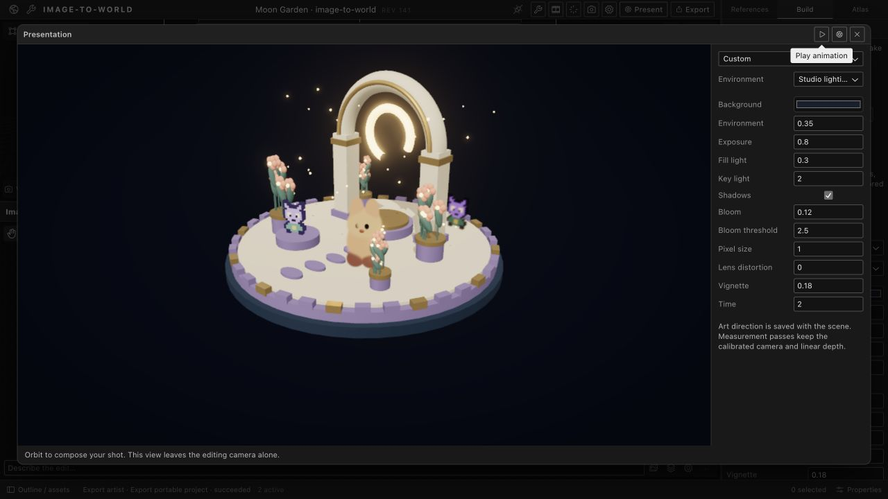

# image-to-world creation demo

The first asset creation release includes a fully local, reproducible **Moon Garden**.
It mixes authored Three.js geometry, native primitive/light nodes, an animated
Gaussian character, seeded fireflies, and two representations of a pixel reference.
No image, 3D-generation, or Atlas provider was called to build this demo.


The same source image becomes an extruded voxel asset and a Gaussian asset through
`examples/pixel-sculpture.ts`. The pixel presentation uses a solid background,
crisp output edges and no bloom. It is a stylized extrusion, not inferred hidden
geometry.


## Reproduce

From a frozen install, start an empty project:

```sh
bun install --frozen-lockfile
bun run image-to-world open /absolute/path/to/new-demo --port 4320 --no-browser
```

In another terminal:

```sh
bun examples/create-demo.ts http://127.0.0.1:4320
bun run image-to-world export project --out /absolute/path/to/new-web-scene --url http://127.0.0.1:4320
python3 -m http.server 8080 --directory /absolute/path/to/new-web-scene
```

The recipe refuses a nonempty project. It creates the pixel reference, compiles
three procedural nodes, places native geometry and a light, registers a camera
and a local image reference, sets art direction, renders a fixed time, and bakes
GLB/PLY assets. The destination for export must also be new. Source, parameters,
asset provenance and declared dependencies travel with the exported project.

Additional actions exercised during the build:

- Independent cinematic and pixel renders without moving the editor camera.
- Successful live code replacement after visually refining the Gaussian face.
- Mesh-to-RGBD capture with `render --targets node_pixel_plinth --rgbd`, producing
  aligned context without a model call. The redundant points display was hidden
  for the final beauty view; the capture remains usable as Atlas context.
- Presentation playback, separate camera controls, and the editable Export prompt
  with working copy feedback.
- Standalone export served directly from a static HTTP server. Its browser
  console reported no warnings or errors. The page uses local files and needs no
  editor API or provider credentials.
- Exported asset paths reopened successfully through a fresh WorkspaceStore test.

The final garden bake contained **3,444 Gaussians** and **three mesh content roots**
with no bake omissions. One final 1280×720 render plus GLB/PLY bake took **3.1 seconds**
on the development machine with an already started renderer. This is a measured
example, not a general performance guarantee.



## Verification

- `bun run check`: passed.
- `bun run test`: **167 passed**, 1,130 assertions.
- `bun run build`: passed; Vite still reports the large graphics bundle advisory.
- Clean temporary checkout: frozen install, production build, and fresh loopback
  launch passed with both World Labs and FAL credentials absent.
- Checked-in demo recipe ran successfully against a second empty project.

Tests cover native-size reference placement without jobs, asset-only generation,
source/dependency pinning, failed module rebuild retention, deterministic sampling,
overlapping build ownership, deleted destinations, shared parent transforms,
GLB/PLY output, ordinary PLY classification, opaque RGBD depth round trips,
context preparation, undo/redo and portable-project reopening. Existing mocked
provider/decomposition/concurrency tests remain green.

Project schema is now 6. Existing older projects are rejected and were not migrated
or edited for verification. Procedural modules are trusted executable project code;
this release does not sandbox arbitrary third-party scripts. Fixed-time baking
cannot preserve arbitrary runtime behavior or screen effects, so those remain in
the portable web player and source. RGBD capture rejects unsupported surfaces
instead of estimating a misleading depth. Additional design directions and the
implemented scope are recorded in `IMAGE_TO_WORLD_PLAN.md`.
