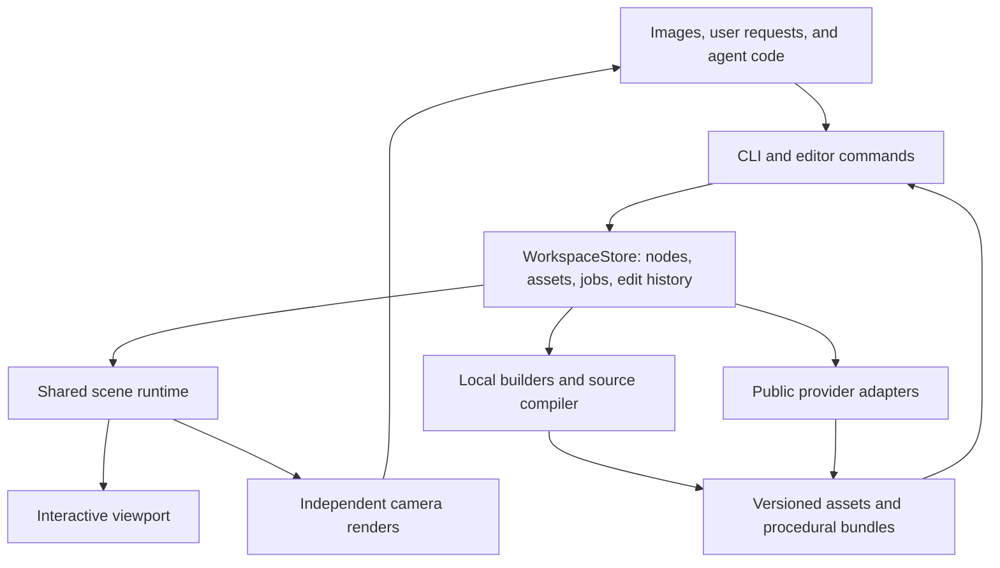

# image-to-world: image-led, agent-authored world building

Status: first implementation built on `codex/image-to-world-vision`, following PR #1
(activity styling already pushed as `37baeed`). This document preserves the broader
design direction; the shipped contract is defined by CLI schemas and the source.

Implemented in this pass: product/CLI rename and schema 6; native-size, no-key image
references; explicit asset/reference/pose generation modes; primitive/material/light
nodes; trusted live TS/JS modules with parameters, seeded randomness, absolute-time
sampling, preflight, watch/rebuild, guarded application and source snapshots;
independent rendered inspection; native image surfaces/sprites and GLB animation;
URL import with provenance; pixel-to-voxel/Gaussian recipes; PLY classification;
opaque mesh-to-RGBD context capture; dedicated Atlas guidance; presentation view
with environment maps, shadows, bloom, pixel treatment and lens warp; top-right
Export prompt; fixed-time GLB/PLY baking and a portable shared-renderer web player.

The design sections below also describe follow-on extensions. This pass does not
provide an untrusted-code sandbox, physics checkpoints, rig editing, automatic
hidden-surface reconstruction for pixel art, a universal file converter, or a
hosting/deployment service. Camera solving, observation and fitting remain the
spatial planning tools; arbitrary ray-query APIs are a future extension. Atlas's
existing request settings stay in the existing settings contract, isolated by its
workflow UI and request builder, rather than introducing an additional provider
configuration framework. GitHub repository identity remains `neilsonnn/worldbash`.

Live code can use Three.js and browser APIs, but host-managed sampling is a finite,
deterministic animation contract. Custom interaction listeners and renderer effects
are module-owned and require cleanup. GLB/PLY baking reports unsupported effects;
portable web export retains source and live behavior. A lens warp is an aesthetic
presentation effect, not a calibrated fisheye camera model.

## 1. Product direction

**image-to-world is first and foremost an asset creation toolkit: a place to make
beautiful, useful, portable 3D assets and scenes from images, code, existing assets,
and generative models.**

The agent is an art director as well as a builder. It should satisfy the user’s
creative goal, render and inspect its work, and refine composition, lighting,
materials, silhouette, and presentation. Quality means appropriateness to the
style: a crisp pixel diorama should not inherit cinematic bloom and glossy IBL.

Add a Presentation view over the same scene graph, with editable art-direction
presets, environment maps, lighting, tone mapping, bloom, pixel output, and optional
lens effects. Keep beauty effects out of measurement/depth passes.

Add an Export button in the top-right header. It opens an editable copyable agent
handoff prompt asking the agent to use the assets, procedural sources, materials,
lighting, effects, and camera presentation to build whatever web experience or
artifact the user wants. Portable files and source are the foundation; the agent
can adapt the implementation freely.

An image can be a reference, a camera-aligned plate, a source of depth, a texture,
an object-generation input, or a style target. A scene can combine authored
geometry, imported meshes, procedural systems, sprites, point clouds, and Gaussian
splats. Agents can choose and combine these representations as the work develops.

Agent authorship is a first-class way to create every representation. A useful
agent might construct a room in code, download a car, generate one missing prop,
make a procedural splat character, and use Atlas to explore the surrounding
background. That entire composition belongs in one editable project.

The core experience is:

1. Give an agent an image and ask it to build something.
2. The agent brings that image into the project and places it as useful evidence.
3. It inspects the scene, authors or acquires content, renders its own views,
   compares them with the reference, and iterates.
4. The human sees the result developing in the editor, including agent activity,
   and can select, reposition, hide, inspect, or replace the content at any time.
5. The project remains usable after the agent disconnects or the editor restarts.

The first release must demonstrate this with local authoring and with optional
provider workflows. Opening, placing references, building geometry, running
project-authored procedural nodes, and rendering must work without API keys.

## 2. What the code already provides—and what currently constrains it

| Area                  | Existing implementation                                                         | Required change                                                                            |
| --------------------- | ------------------------------------------------------------------------------- | ------------------------------------------------------------------------------------------ |
| Scene state           | Shared transforms, graph commands, capabilities, spatial bounds, picking, undo  | Preserve and extend these contracts to authored content                                    |
| Agent operations      | CLI schemas, observations, masks, mesh fitting, immutable inputs, guarded edits | Add local construction, source builds, spatial queries, and explicit import modes          |
| Independent rendering | Shared SceneGraph in headless Chrome, per-job camera snapshots                  | Add authored nodes, deterministic time, explicit content filters, and context capture      |
| Meshes                | Embedded GLB, materials rendered by GLTFLoader                                  | Expose materials, basic animation, subasset metadata, and conversion diagnostics           |
| Splats                | SPZ/PLY/splat loading through Spark                                             | Validate file contents, support local construction, and define precise transform limits    |
| Image placement       | `JobRunner.place()` poses an uncalibrated image through World Labs              | Make reference placement immediate and local; reconstruction becomes an explicit operation |
| Image creation        | Image generation normally continues into posing                                 | Make asset output and scene placement independent choices                                  |
| Project format        | A session image grid and Atlas options sit in general settings                  | Keep native image/camera resolutions; scope request constraints to the owning workflow     |
| Workflow UI           | Atlas has a permanent dedicated right column                                    | Introduce a reference/workflow dock with an excellent explicit Atlas surface               |
| Image editing         | Nano-specific settings are embedded in editor state                             | Separate editor drafts from model settings using small typed descriptors                   |
| Code authoring        | An agent can already write files and import generated GLBs                      | Add registered live procedural nodes with source, parameters, lifecycle, and diagnostics   |
| Packaging             | worldbash names, environment variables, config paths, install message           | Rename the executable, UI, source package, docs, and discovery contract together           |

Relevant code: [schema](core/schema.ts), [job placement](web/src/server/jobs.ts),
[formats](core/formats.ts), [generation resolution](core/generation.ts),
[renderer](web/src/lib/scene.ts), [inspection](core/inspection.ts),
[GLB validation](core/mesh.ts), [provider requests](web/src/server/providers.ts),
[editor shell](web/src/components/Editor.tsx), and
[existing CLI skill](skills/worldbash/SKILL.md).

There are specific cleanup items beyond renaming:

- `core/formats.ts` derives a project-wide format partly from capture source
  metadata. Editable camera projections must supply camera state; provider grid
  preparation belongs at submission boundaries.
- `core/inspection.ts` mixes generic scene inspection with Atlas context membership.
  Keep generic geometry/camera inspection independent, with workflow validation
  reported separately.
- `store.ts` currently classifies every `.ply` as a splat. Inspect its header:
  a point cloud, triangle mesh, and Gaussian PLY are different inputs.
- Scene lights are presently installed in the renderer. Authored lighting needs
  persisted shared settings/nodes and parity with headless output.
- Documentation still contains an old schema-version statement. Update executable
  examples and contracts together, and check them against generated schemas.

## 3. Architecture



The core remains small:

- **Assets** hold immutable source and output bytes, dependency/provenance links,
  and import metadata.
- **Nodes** instantiate content with one authoritative `transform`, a parent,
  visibility, and the relevant typed payload.
- **Commands** are the sole scene mutation path for the UI, agents, and persistent
  actions initiated by procedural content.
- **Jobs** own asynchronous work, frozen inputs, progress, cancellation, results,
  and ownership checks.
- **The scene runtime** evaluates the same node contracts in the viewport and in
  isolated headless renders.
- **Workflows and skills** compose these primitives into useful approaches.

Retain `generation.submit` as the single existing entry for generation intent;
provider requests stay in runners. Local construction uses ordinary undoable
commands. Compilation/conversion runs as jobs under the same command service and
job lifecycle, without inventing a second persistence or scheduling system.

Use a small static dictionary of node definitions, operation schemas, provider
capabilities, labels, and simple parameter descriptors. This work does not need an
editor-plugin marketplace or a universal component framework. Project-authored
scene modules are a concrete supported content type.

## 4. Code-authored scene nodes

This is a central part of the first release, not a distant extension point.

### Two complementary authoring paths

**Build an asset.** An agent writes TypeScript, Python, Blender code, or another
local program and produces a GLB, image, point cloud, or Gaussian splat file. It
imports the result through the CLI. The editor does not need to understand the
program that created it. Optional provenance records the source and tool version.

**Keep code live.** An agent writes a project TypeScript module and registers it
as a procedural node. The module constructs Three.js objects and/or Spark splats
and can respond to time, editable parameters, and supported interaction events.
This supports procedural architecture, animated characters, effects, simulations,
custom shaders, and representations we have not anticipated.

### Minimal module contract

A module follows this lifecycle; see `core/module-contract.ts` and the code skill
for the exact shipped types:

```ts
import type { SceneModule } from "image-to-world/runtime";

export default {
  parameters: {
    height: { type: "number", default: 1.4, min: 0.1, max: 10 },
    bounce: { type: "number", default: 0.08, min: 0, max: 1 },
    color: { type: "color", default: "#db946d" },
  },

  async create(ctx) {
    const { THREE, spark, params } = ctx;
    const object = new THREE.Group();
    const character = new spark.SplatMesh({
      constructSplats(splats) {
        // Agent-authored geometry: add splats with positions, colors,
        // scales, orientation and opacity in the node's local space.
      },
    });
    object.add(character);
    await character.initialized;

    return {
      object,
      sample({ time }) {
        character.position.y = Math.sin(time * 2) * params.bounce;
      },
      dispose() {
        character.dispose();
      },
    };
  },
} satisfies SceneModule;
```

The host supplies the project's pinned Three.js and Spark instances. Modules do
not bundle duplicate copies of those engines. Additional dependencies are resolved
at explicit build time from installed, locked dependencies; opening a project
never installs packages or fetches executable modules from a CDN.

The host also supplies asset access by ID, a seeded random source, cancellation,
and diagnostic reporting. Assets used by a module are declared dependencies and
included in frozen render snapshots. Generated runtime geometry belongs inside
the module's local content root; `node.transform` supplies its placement in the
world. Module code must not move that authoritative wrapper or mutate workspace
records directly.

### Node registration and acknowledgement

A procedural node records:

- Source asset and compiled bundle asset, including content hashes and runtime
  contract version.
- Parameter values and declared asset dependencies.
- The same identity, transform, hierarchy, visibility, and capabilities as other
  content nodes.
- Optional provenance linking the source image, actor, and build job.

The Outline shows a normal named node with a code indicator. Properties exposes
parameters, source location, active build, errors, rebuild, and bake/export actions.
The activity feed records source changes, compilation, activation, and failures.
Steady animation does not generate a stream of per-frame log events.

### Evaluation and ownership

- `create` can be asynchronous; ready state must include required assets.
- `sample({time})` supports deterministic seeking. The interactive viewport and
  `render --time` use the same evaluator and seed.
- Standard mesh geometry uses shared bounds and picking. Dynamic splats and custom
  vertex shaders supply local bounds and, when necessary, a pick proxy through
  `NodeSpatial`. These are mandatory when automatic geometry inspection is wrong.
- Helpers and pick proxies remain outside content bounds and exported imagery.
- Time-varying geometry has bounds evaluated at the requested time. Optional
  conservative motion bounds can serve interactive framing.
- `dispose` and cancellation release resources, timers, subscriptions, textures,
  and GPU buffers when a node is rebuilt or removed.
- A module owns its internal object tree. Users edit exposed parameters or bake
  parts into ordinary nodes when independent editing is needed. We do not create
  two competing authorities for module-generated children.
- Persistent changes triggered by interaction use the command service. Animation
  samples and simulation ticks remain transient runtime state.

A stateful simulation can later use a reset/step/checkpoint contract. The first
release guarantees reproducibility for deterministic time-sampled modules and
labels modules that cannot seek. It must not quietly render a different state
in the headless worker.

### Compilation and live updates

1. Register an explicit local source file and its dependencies; there is no
   mandatory task-folder structure.
2. Compile TypeScript into a content-addressed bundle and capture source bytes.
3. Validate exports, parameters, asset dependencies, and runtime compatibility.
4. Preflight in a disposable headless renderer, with a process timeout and useful
   errors, before activating a new build.
5. Commit the new bundle binding through an undoable, guarded command.
6. Activate atomically; a failed compile or preflight leaves the previous build
   visible and identifies the failed candidate in Properties/activity.

Watch mode is opt-in per registered source. Use latest-build ownership so a slow
older compile cannot replace a newer version. Undo restores the previous bundle
and parameters. It does not silently rewrite the agent's source file; the UI shows
when source and active build differ. A render snapshots the active bundle, its
transitive inputs, and parameter values before it starts.

### Execution boundary

Live arbitrary JavaScript is **trusted project code** in the first release. A
small lifecycle API is an integration contract, not a security sandbox. It cannot
promise to prevent an infinite loop or arbitrary same-realm browser behavior.
Heavy compute belongs in build jobs/workers. Headless preflight and an explicit
Disable module action improve recovery but do not make malicious code safe.

Downloading a model remains a data import. Importing a project or code file does
not automatically execute its scripts. Authoring/registering code explicitly
initiates execution; routine updates from that authorized authoring workflow do
not require repeated confirmations.

If running untrusted third-party modules becomes a product requirement, move the
entire scene runtime behind an isolated rendering host with a narrow message
protocol. A Three.js Object3D cannot simply be transferred out of a sandboxed
worker into the main renderer. Isolation must encompass rendering or exchange
geometry buffers; it deserves a separate implementation and threat model.

## 5. Shared scene and spatial contracts

Keep the existing ownership rules and make them more expressive where needed:

- One authoritative local pose per node, inherited world transforms, and generic
  transform/parenting/selection paths.
- Units are declared project scene units. Use a meter-based authoring convention,
  while labeling monocular reconstructions as arbitrary scale until anchored.
- Camera intrinsics belong to camera nodes. Source assets retain historical
  calibration evidence without overriding an edited camera.
- Add flat typed node payloads or discriminated node schemas, with shared fields
  kept first-class. Avoid an untyped metadata bag for spatial state.
- Extend capabilities to describe uniform-only scaling and available render/query
  operations, not just three booleans. Mixed selections use the intersection.
- Read-only spatial tools return evidence and preconditions: bounds, ray hits,
  screen projection, depth unprojection, distances, and alignment proposals.
- Apply placement/grounding/alignment proposals through normal commands, with
  guards on relevant geometry bindings, transforms, and ancestors.

Spark's current documentation calls out uniform-scale behavior for SplatMesh.
Verify the installed version and reject unsupported transforms through the shared
capability contract. If nonuniform scale is required, bake the affine change into
Gaussian centers/covariances using a tested conversion; never silently average
scales or compensate only in a gizmo.

## 6. Images become independent scene inputs

Separate these actions explicitly:

| Action          | Outcome                                                     | Requires a provider?                                |
| --------------- | ----------------------------------------------------------- | --------------------------------------------------- |
| Import          | Original bytes enter the asset library                      | No                                                  |
| Place reference | Image plane or camera-aligned reference appears immediately | No                                                  |
| Set camera      | User/agent supplies or edits camera pose and intrinsics     | No                                                  |
| Reconstruct     | Estimate camera/depth and integrate validated components    | Only for the selected reconstruction implementation |
| Use as material | Bind image to an object or sprite                           | No                                                  |
| Generate/edit   | Produce a candidate image asset                             | Only for the selected model                         |
| Apply to RGBD   | Stage image replacement plus required depth refresh         | Depends on the chosen depth workflow                |

An unknown camera can start from a stated FOV/pose assumption. Label it as an
assumption; placing an image in 3D is not proof of calibrated reconstruction.

Keep the capture composition where useful: parent, camera/image, and optional
points. Workflow validation decides whether a capture is usable RGBD. Generic
editing still permits reparenting and deletion. A reference without points is
valid editor content even when it is ineligible for Atlas.

Preserve source dimensions and bytes. Adapt/crop/resample to a provider's grid at
submission, transforming intrinsics, masks, and depth consistently. Retain those
derived inputs and their mapping for provenance. Different scene images and
cameras can have different resolutions.

Give image nodes explicit content/display behavior: a reference plate, a textured
surface, or a billboard/sprite. Reference overlays can be excluded from a clean
render while a sprite remains real scene content. Bounds must describe the actual
local surface, not a hidden display offset that contradicts inspection.

## 7. Local geometry, materials, assets, and characters

### Direct authoring

Add native box, plane, sphere, cylinder, cone, and capsule geometry with typed
parameters. Support standard/unlit materials, color, opacity/alpha mode,
roughness, metalness, emissive color, and texture references. Add explicit
ambient/directional/point lights and consistent render settings.

A concise batch command can build a whole graybox without an external DCC.
Procedural modules cover richer code-generated structures; external scripts can
produce arbitrary meshes. Repeated objects can share geometry and materials;
renderer batching/instancing is an optimization that must preserve node identity
for selection, picking, bounds, and commands.

### Existing and generated assets

- Retain self-contained GLB as the preferred mesh interchange format.
- Support local files and a deliberate URL-fetch/import command. Record source
  URL, creator/license when supplied, retrieval time, and content hash.
- Download into staging, validate bytes and declared size/type, then register an
  immutable asset. Use bounded redirects and block server-side requests to
  private/local services. Local file import remains a separate explicit path.
- Preserve raw outputs when conversion is required. Reject unsupported required
  GLB extensions with a useful reason and conversion guidance.
- Keep model search/acquisition optional. An agent can use its own web tools and
  import a licensed/downloadable asset; a built-in marketplace is unnecessary.
- Build an optional explicit conversion job around installed tools when a common
  format actually needs it. No silent startup installs or hidden remote fetches.

A car is just a mesh instance. Image outpainting produces image evidence or
texture assets; it does not directly modify a car's geometry. The workflow chooses
whether to retexture, regenerate, replace, or manually edit that instance.

### Character support

First pass: import static or skinned GLBs, expose available animation clips, select
a clip and sample time, and render the same pose headlessly. Preserve rig/material
structure within the asset. Bone editing, retargeting, gameplay physics, and a
full animation timeline are later work. A live module can already animate its
own character using the runtime's deterministic sampling contract.

## 8. Procedural splats and pixel art

Make Gaussian splats a supported authoring representation independent of Atlas.
The installed Spark package already exposes `PackedSplats.pushSplat`; official
Spark documentation also demonstrates procedural collections and image-derived
splats. This is a concrete basis for local construction.

Support three clearly described starting points:

1. A pixel image as an unlit nearest-filtered sprite with correct alpha.
2. A pixel image extruded into shallow voxel geometry, with explicit pixel scale,
   thickness, palette treatment, and optional depth input.
3. A procedural Gaussian object built from explicit splat data, a pixel/depth
   conversion, or a live module.

A flat conversion is a flat object. An extrusion has authored thickness. A depth
lift uses supplied/estimated visible-surface depth. None recovers an unseen back
or a complete character automatically. An agent can author those parts, use
additional views, or call a suitable model and import the output.

First-pass outputs include a portable Gaussian PLY with validated Gaussian
properties plus the source image/code and construction parameters. Implement and
test the exact writer against the pinned Spark reader. Plain vertex PLY remains
a point-cloud input. A live procedural splat character can be baked into a static
asset at a chosen time.

Do not claim mesh-quality depth/ID passes for splats without defining opacity and
surface semantics. In the first release, splats support color rendering and their
existing picking/spatial contracts; geometry passes return explicit unsupported
coverage information or fail when the caller requires complete coverage.

## 9. Independent observation and rendering

Rendering is the agent's visual feedback loop. Expand the existing worker rather
than adding a separate miniature renderer.

A render request freezes:

- Camera/projection and output dimensions.
- Selected content IDs, exclusions, and inherited transforms.
- Geometry, material, image, source-code, and transitive asset versions.
- Module parameters, deterministic time, seed, lights, and render settings.
- Requested passes and reference comparisons.

Return color, optional supported geometry passes, camera metadata, node-ID mapping,
bounds, omitted/unsupported content, timing, and dependency hashes. Human camera,
selection, playback, and hover state do not change.

Add `scene inspect --rendered` using the independent worker for actual bounds
without an open editor. Keep fast structural inspection available and clearly
identified. Add focused spatial queries rather than making agents reverse-engineer
projection math from screenshots.

A new **capture rendered geometry as RGBD** operation bridges local authoring and
Atlas. It must use the exact shared camera convention, camera-forward linear depth,
consistent pixel orientation, valid/transparent-background masks, and frozen
content. Initially support opaque mesh/primitive geometry, including supported
module output. Unsupported transparent/splat surfaces cannot be silently treated
as trustworthy depth context.

This enables: graybox -> render RGBD -> Atlas appearance/exploration -> inspect ->
keep the generated background alongside editable foreground geometry.

## 10. Providers and the dedicated Atlas workflow

Preserve World Labs as a strong, explicit workflow:

- `images2PosedRGBD` for supported image reconstruction.
- `atlasGenerate` for exploration and background expansion at specified cameras.
- `posedImages2Splats` as an explicit optional reconstruction action.

Use only documented public tasks available through the installed SDK. Recheck
SDK/documentation alignment during implementation. Current online Atlas docs
contain more nuanced context/target/depth constraints than the old project-wide
128-view statement; validation and tests must follow the supported API version,
not preserve stale global assumptions.

The Atlas skill teaches the agent to establish useful context, choose cameras,
inspect overlap/geometry, render previews, maintain scene description, refresh
edited depth, and incorporate coherent output. It should recommend useful
workflows while allowing the agent to change its approach.

Atlas context membership, request grid, prompt enhancement/cache, seeds, return
settings, and path-generation options move into the Atlas-owned settings/request
contracts. They do not constrain general scene content or all image operations.

Keep provider-specific input JSON available for advanced requests. Shared operation
metadata describes provider, operation, inputs, outputs, readiness, and cost
information when known. The initial implementations are World Labs, FAL, and local
operations; adding a provider should not require rewriting the scene schema.
Do not pretend one universal image/mesh request fully describes every model.

Retain staged image/depth application and newest-submission ownership. An image
edit that updates active RGBD context publishes aligned RGB plus depth together.
A failed refresh preserves the previous active scene and the candidate assets.
Standalone sprites, materials, and image assets do not require a depth job.

## 11. CLI, agent handoff, and skills

The proposed CLI vocabulary below illustrates the target experience. Every command
must be backed by a discoverable schema; these commands are not all implemented.

```sh
image-to-world open ./my-project
image-to-world doctor
image-to-world schema nodes
image-to-world schema commands
image-to-world schema modules
image-to-world schema operations

# Import is local. Reference placement does not implicitly call a model.
image-to-world import ./reference.png
image-to-world image place <asset-id> --mode reference --camera camera.json

# Direct geometry and existing assets.
image-to-world scene add primitive --shape box --size 4,3,5 --name Room
image-to-world assets fetch <download-url> --out-name car.glb
image-to-world scene place <mesh-asset-id>
image-to-world command @graybox-batch.json --actor Builder --request-id room-v1

# Agent-authored code becomes an acknowledged scene node.
image-to-world module add ./character.ts --name 'Splat visitor' --watch
image-to-world module params <node-id> --file character-params.json
image-to-world module inspect <node-id>
image-to-world module bake <node-id> --time 1.5

# Independent visual feedback.
image-to-world render <camera-id> --time 1.5 --reference <image-id>
image-to-world scene inspect --rendered
image-to-world scene query ray --camera <camera-id> --pixel 640,360
image-to-world capture rgbd <camera-id> --targets <geometry-group-id>

# Provider workflows stay explicit.
image-to-world atlas pose <image-id>
image-to-world atlas generate --context <capture-id> --camera camera.json
image-to-world model run --provider fal --model <endpoint> --file input.json
```

All scene-affecting wrappers use the same command service, actor attribution,
preconditions, idempotency, and undo. Jobs retain their independent output assets.
No command assumes it owns the human viewport or global selection.

### Image pasted into a chat

Support the actual handoff available to the host agent:

- If the host exposes an attachment file, the agent imports that file.
- If it exposes image bytes, the agent materializes an ordinary temporary file or
  uses a binary import endpoint, then places the returned asset.
- The editor supports its own paste/drop import using the same path.
- A copyable starter instruction points the agent at the project URL and skill.

The app cannot promise automatic access to attachments in every chat client.
Avoid a global clipboard watcher or dependence on a particular agent vendor.
An MCP wrapper is a later convenience over the command API if actual hosts need it.

### Skill layout

- `skills/image-to-world/SKILL.md`: general reference import, inspection,
  commands, authoring options, rendering, errors, and concurrent work.
- `skills/image-to-world-atlas/SKILL.md`: World Labs context, camera exploration,
  RGBD consistency, image/depth editing, paths, optional splats.
- `skills/image-to-world-code/SKILL.md`: module lifecycle, Three.js/Spark examples,
  deterministic time, hot reload, bounds, cleanup, bake, and diagnostics.
- `skills/image-to-world-objects/SKILL.md`: observation, object completion,
  generation/acquisition, mesh placement, shared-background cleanup.

Keep the general skill short and link specialized workflows. Avoid teaching every
agent all provider details or requiring a fixed project-folder recipe.

## 12. Editor experience

Replace the permanently Atlas-centered column with a compact dock containing
**References**, **Build**, and **Atlas** surfaces. The selected workflow stays
visible; direct viewport controls, Properties, Outline, and Project assets keep
their existing ownership.

- **References:** imported/pinned image evidence, source cameras, display modes,
  reconstruction status, and actions to place or reconstruct.
- **Build:** useful starting actions—graybox, code module, object from image,
  import asset, sprite/splats—and general model discovery. These are suggestions,
  not a compulsory wizard.
- **Atlas:** the focused context tiles, scene description, camera/path generation,
  and settings that make the current tool good at exploration.
- **Properties:** native geometry/material/light parameters; module parameters,
  source/build status; imported animation settings; normal transforms throughout.
- **Image editor:** annotations, references, explicit versions, and model choices
  whose fields come from operation descriptors. Model-specific options remain
  identifiable and validated.
- **Activity:** preserve Summary/Actions/Trace, actor filters, resource badges,
  and optional spatial presence. Add compile/import/bake actions automatically.

Use existing shared headers, gray Radix controls, immediate tooltips, neutral
buttons, compact spacing, and theme tokens. No magic-wand icons. Build a fresh
workspace on arrival with reference import and local authoring readily available;
provider setup belongs with the operation that needs it.

## 13. Concurrent agents and reproducibility

Continue the current model: agents share the server, ordinary files, and command
contracts. Each agent chooses its own source/output paths and operates on named
nodes. Separate modules or objects can be built simultaneously.

- Snapshot all job inputs, including source dependency graphs and model inputs.
- Use field guards rather than whole-workspace revision locks for independent
  edits; unrelated actors keep progressing.
- Atomically commit batches and module activations. Maintain latest-job ownership
  outside undo.
- A worker uses targeted revert for its own unchanged edit, rather than global
  undo of another worker's newest work.
- Shared source edits and background cleanup need a nominated owner; source-file
  changes use content hashes and temporary-file/atomic replacement practices.
  Detect conflicting changes rather than merging arbitrary code silently.
- Give compilation/conversion, headless GPU rendering, and remote jobs separate
  bounded scheduling lanes. Cancellation must distinguish stopping local work
  from cancellation supported by a provider.
- Actor identity and automatic resource tracking drive the UI; code and agents
  do not need to manage presence animations or activity presentation.

No distributed lock service, shared chat orchestration runtime, or second project
store is required for this local multi-agent model.

## 14. Rename and contract changes

Use **image-to-world** consistently for the product, command, source packages,
window/page title, starter instructions, docs, and skill discovery.

- Rename Bun scripts and CLI bin to `image-to-world`; remove the old executable
  contract and update every test/example together.
- Rename application-owned variables to `IMAGE_TO_WORLD_*`, default data folder
  to `.image-to-world`, config namespace to `image-to-world`, and server/launch
  identity/build markers. Keep provider-owned variables such as `WLT_API_KEY`
  and `FAL_KEY` unchanged.
- Use a new project schema version for the changed node/settings contracts.
  Reject old schemas with a clear message. Do not migrate, alias, silently rewrite,
  or delete existing projects.
- Leave previous credential files untouched. New configuration uses the new
  namespace; any deliberate transfer is an explicit setup action, not a fallback
  reader embedded in startup.
- Update `AGENTS.md` to describe the general canvas and scope World Labs rules to
  its adapter/workflow. Preserve shared spatial, command, result ownership,
  verification, and delivery rules.
- Keep historical research/demo reports identifiable as historical documents;
  current install instructions and schemas must describe the new product.
- Rename the GitHub repository and update published URLs at the release cutover,
  after checking availability. That is separate from renaming the user's current
  checkout directory, which is not required and must not break local app bindings.
  The current workstream does not publish an npm package merely by renaming it.

The plan lives on `codex/image-to-world-vision`, based on PR #1. Keep the already
reviewable decomposition/styling PR separate. Implementation PRs can stack on it
until it lands; do not merge it as a side effect of this workstream.

## 15. Export and portability

A project must remain useful outside the current editor session:

- Project bundles include schema, referenced assets, procedural source and active
  bundles, dependency/build metadata, and attribution. Exclude credentials and
  machine-local configuration; do not package transient signed download URLs as
  permanent dependencies.
- Export mesh-compatible selected content as GLB using the shared evaluated
  geometry/material/camera/light contracts at a specified time.
- Bake procedural nodes when the destination cannot run code. Preserve originals
  in the project so baking is reversible by ordinary edits.
- Export Gaussian content separately in a supported splat format. A mixed-scene
  bundle includes a manifest of transforms and relationships.
- Report unsupported content explicitly. A GLB export that silently omits a splat
  character or shader-dependent effect is not a faithful scene export.

## 16. First implementation pass and acceptance gates

This is a substantial first pass with six dependent milestones. Each milestone
must leave a usable tool and satisfy its tests before the next integration step.

### A. Identity and provider-independent foundations

Rename product/CLI/contracts; introduce fresh schema; reorganize general versus
Atlas settings; separate image import, reference placement, and reconstruction.
Update discovery docs, environment setup, default workspace, and panel metadata.

**Gate:** a fresh project launches without keys, imports images of different sizes,
places them without paid jobs, and renders a camera. Atlas constraints do not
reshape unrelated references. Old projects remain untouched and are rejected.

### B. Local authoring and spatial feedback

Add primitive/material/light nodes, shared operation capabilities, independent
rendered inspection and spatial queries. Establish reference/Build dock surfaces.

**Gate:** a CLI-authored room can be selected, parented, duplicated, transformed,
inspected, rendered, exported, undone, and reopened with consistent results under
translated/rotated/scaled parents. Mixed selections obey shared capabilities.

### C. Live procedural nodes

Implement the source compiler, module contract, parameter UI, asset dependencies,
preflight, watch/rebuild, guarded activation, diagnostics, deterministic sampling,
and bake. Use the existing shared renderer and GPU disposal paths.

**Gate:** an agent-authored animated splat character loads as a named node; code
and parameter updates appear without restarting the editor; a broken rebuild
leaves the last successful build visible; undo/reopen/headless rendering reproduce
the same version and time. Two modules can update independently.

### D. Mixed assets and character workflows

Add validated URL acquisition/provenance, native sprite/pixel settings, local
pixel-to-voxel/splat construction, PLY classification, and imported GLB animation
clip inspection/sampling. Retain general model calls and object-decomposition tools.

**Gate:** a reference-led scene contains a web/imported mesh, animated or posed
character, authored geometry, and pixel-derived or procedural splats. Unsupported
formats and materials produce actionable diagnostics; no remote scripts execute
as a result of data import.

### E. Atlas as an integrated specialized workflow

Finish Atlas-specific settings/UI/skill, audit public SDK request validation,
and implement mesh/primitive RGBD capture for context. Preserve output ownership,
staged depth refresh, and explicit splat generation.

**Gate:** mocked command tests cover graybox context -> Atlas result integration
without corrupting the editable scene. An explicit real-provider demonstration
can later exercise reference posing and background expansion; routine tests do
not submit paid requests. Depth-invalid or unsupported context fails clearly.

### F. End-to-end release example and packaging

Create one fresh **Reference Workshop** project showing the whole experience:

1. Import a street/workshop reference and place its camera-aligned image locally.
2. Author floor, walls, openings, and a few props as editable geometry.
3. Import a car or character asset with recorded provenance and fit it to a view.
4. Add a code-authored splat visitor with editable color/size/bounce parameters.
5. Add a pixel-art conversion so its explicit flat/depth/extrusion semantics are
   inspectable alongside the live code example.
6. Run two concurrent workers on distinct objects/modules; each renders its own
   source and secondary views without moving the human viewport.
7. Exercise a stale edit, a compilation error, recovery, targeted revert, and
   depth-refresh failure, retaining the correct active content in each case.
8. Optionally pose/expand the background through the dedicated Atlas workflow,
   retaining the authored foreground objects and useful reference evidence.
9. Reopen the project, render fixed times/cameras, bake/export selected content,
   and show what is portable and what requires the procedural runtime.
10. Present the scene, source, image comparisons, activity history, validation
    results, and clear remaining limitations.

**Gate:** the offline example is reproducible from checked-in small fixtures and
commands; provider outputs are a separately identified demonstration. A clean
frozen Bun install launches a disposable project with no runtime dependency
installation. Capture real performance/memory measurements on the test machine.

## 17. Verification strategy

Run `bun run check`, `bun run test`, and `bun run build`. Use a temporary
WorkspaceStore, mocked providers, and disposable CLI projects for regression
coverage. Browser checks cover layout, focus/shortcut routing, parameter editing,
module diagnostics, drag behavior, and visual output.

High-value tests include:

- No paid job during import/reference placement or local authoring.
- Per-camera resolutions and correct intrinsics/mask/depth transformation at an
  Atlas submission boundary.
- Every new node through shared bounds, picking, parenting, transforms, export,
  undo, and mixed selection, including nontrivial ancestor transforms.
- Procedural dependency snapshots, source changes during rendering, out-of-order
  builds, cancellation, failed hot reload, removed destinations, and resource
  cleanup over repeated rebuild/delete cycles.
- Fixed-time rendering of procedural animation and imported GLB clips; equivalent
  live and headless cameras; deterministic local fixtures with tolerances suited
  to GPU rendering.
- Analytically known opaque geometry for linear-depth/RGBD round trips; explicit
  coverage failures for unsupported splats/transparency.
- Concurrent disjoint edits, conflicting shared-file hashes, receipt replay,
  latest-owner application, and targeted revert.
- Asset download/type checks, embedded GLB dependencies, PLY classification,
  source/provenance retention, and exports with explicit omission manifests.
- Missing provider credentials leave the editor/local workflows usable.

Benchmark a representative mixed scene before choosing budgets: renderer startup,
first useful frame, subsequent render latency, hot-reload latency, draw calls,
texture/geometry/splat counts, and memory after repeated rebuilds. Set regression
thresholds from those measurements; avoid claiming universal hardware performance.

## 18. Follow-on work

After the complete first pass, prioritize based on actual projects:

- Untrusted module isolation and a render-host protocol if third-party executable
  scenes become a supported distribution format.
- Simulation checkpointing, richer interaction events, and stateful playback.
- Full rig editing/retargeting, advanced timeline tools, or physics integration.
- Better automatic alignment and segmentation with measurable quality feedback.
- Additional provider adapters, asset catalogs, and an MCP transport wrapper.
- Richer splat editing, transform baking, and precisely defined mixed depth passes.
- Large-world streaming, progressive assets, and more aggressive instancing/LOD.

These should build on the same scene/runtime/command contracts. The first pass
already exposes unrestricted local artifact authoring and trusted live scene
modules, so agents need not wait for each specialized feature to experiment.

## 19. Sources and feasibility notes

- [Atlas Generate](https://docs.atlas.worldlabs.ai/atlas-generate): camera-directed
  RGBD-context generation, scene-description prompts, and output-depth constraints.
  Keep these checks within the Atlas adapter and verify against the pinned SDK.
- [Atlas cameras and posed images](https://docs.atlas.worldlabs.ai/cameras-and-posed-images):
  reference for camera/depth conventions and request preparation.
- [Posed images to splats](https://docs.atlas.worldlabs.ai/posed-images-to-splats):
  the separate explicit public splat-reconstruction task.
- [Spark procedural splats](https://sparkjs.dev/docs/procedural-splats/) and
  [PackedSplats](https://sparkjs.dev/docs/packed-splats/): existing local Gaussian
  construction primitives. The repository's installed type declarations also
  expose `pushSplat`, making the basic procedural-node example feasible without
  introducing a new generation service.
- [Spark SplatMesh](https://sparkjs.dev/docs/splat-mesh/): object integration,
  bounds, lifecycle, and transform behavior to verify against the installed version.
- [Three.js GLTFLoader](https://threejs.org/docs/pages/GLTFLoader.html) and
  [GLTFExporter](https://threejs.org/docs/pages/GLTFExporter.html): the existing
  mesh interchange foundation. Loading an extension in upstream Three.js does
  not imply that our validator/runtime/exporter already supports it.

The specific pixel-art-to-character trend was not identified by a supplied example.
This plan supports concrete local pixel, voxel, and splat workflows without
assuming a particular third-party method or promising unseen-surface recovery.
